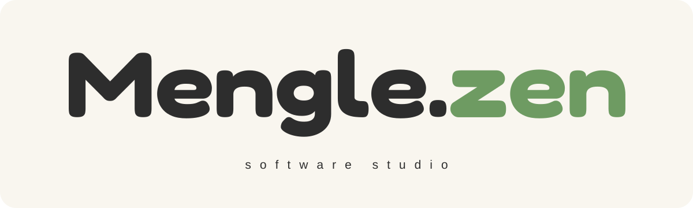
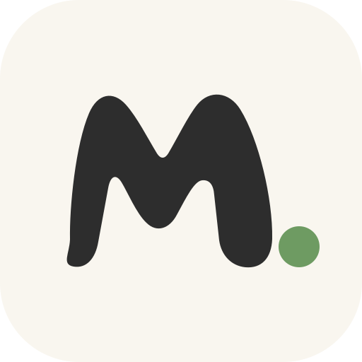
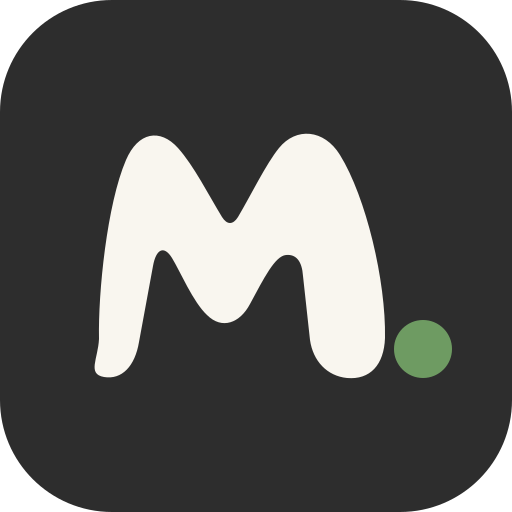

# Mengle.zen · brand at a glance

**맹글젠**은 만들고 싶은 것을 함께 만들어 보자는 이름입니다. 제주도 말 ‘맹글다’(만들다)와 ‘~젠’(~하려고)을 잇고, 영문 표기에는 차분히 몰입하는 `zen`의 느낌을 더했습니다.

## Brand palette

| Color | Hex | Role |
| --- | --- | --- |
| Charcoal | `#2D2D2D` | 기본 글자와 심볼 |
| Green | `#6E9B62` | `.zen`과 포인트 |
| Cream | `#F9F6EF` | 기본 배경 |
| Peach | `#FFB6B0` | 보조 색상 |
| Blue | `#B6D5FF` | 보조 색상 |

시안의 키워드는 **Making · Experiment · Focus · Simple · Joyful**입니다. 차분한 바탕 위에 둥근 형태와 초록 포인트를 사용합니다.

## GitHub assets

| Asset | Preview | Use |
| --- | --- | --- |
| [`banner.svg`](assets/banner.svg) |  | 조직 프로필 상단 |
| [`wordmark.svg`](assets/wordmark.svg) |  | 작은 가로형 서명 |
| [`symbol.svg`](assets/symbol.svg) |  | 크림색 바탕의 아이콘 |
| [`symbol-dark.svg`](assets/symbol-dark.svg) |  | 차콜색 바탕의 아이콘 |

GitHub용 벡터 자산은 제공된 브랜드 시안을 참고해 새로 그렸습니다. 워드마크의 글자 형태는 [Fredoka](https://github.com/google/fonts/tree/main/ofl/fredoka)를 바탕으로 만들었으며, 해당 서체는 [SIL Open Font License 1.1](https://github.com/google/fonts/blob/main/ofl/fredoka/OFL.txt)을 따릅니다. 이 저장소의 로고 자산에 별도 재사용 허락을 부여하는 것은 아닙니다.
